# HS FACOP

Sistema de gestión para una institución de formación odontológica: los tratantes llenan la **historia clínica de ortodoncia** desde un formulario por pasos, la imprimen con la presentación oficial en A4, y los supervisores y la coordinación académica la revisan.

- **Contexto de uso:** Escuela de Post-grado AEO / FACOP (formación en ortodoncia). El **papel firmado sigue siendo el registro oficial**; la aplicación agiliza el llenado y la reimpresión.
- **Naturaleza del proyecto:** producto comercial desarrollado de forma individual, con asistencia de herramientas de IA, mediante desarrollo dirigido por especificaciones ([OpenSpec](https://github.com/Fission-AI/OpenSpec)).
- **Estado:** desplegado en planes gratuitos (Vercel + Render + Neon) y en evolución. Este documento no afirma cifras de uso.

> No es un sistema de gestión de clínicas dentales. Los identificadores técnicos internos (paquete Java `com.odontorisas`, `odontorisas-frontend`) conservan un nombre anterior del proyecto.

## Contenido

[Capturas](#capturas-de-pantalla) · [Funcionalidades](#funcionalidades) · [Arquitectura](#arquitectura) · [Stack](#stack-tecnológico) · [Calidad y pruebas](#calidad-y-pruebas) · [OpenSpec](#desarrollo-guiado-por-especificaciones) · [Ejecución](#instalación-y-ejecución) · [Documentación](#documentación-técnica)

---

## Capturas de pantalla

Capturas con datos de prueba (alias ficticios); no contienen datos de pacientes ni de usuarios reales. Están en [`docs/screenshots/`](docs/screenshots/).

| Inicio de sesión | Inicio (métricas por rol) |
|---|---|
| 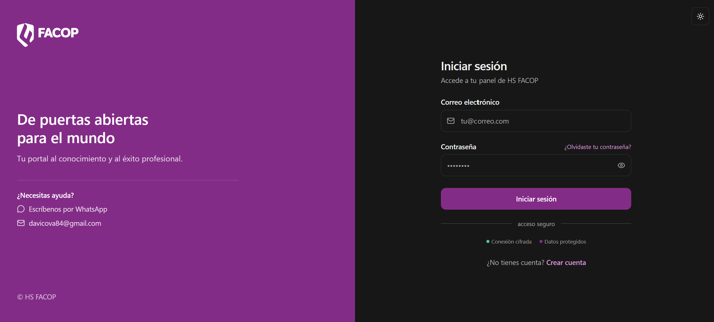 | 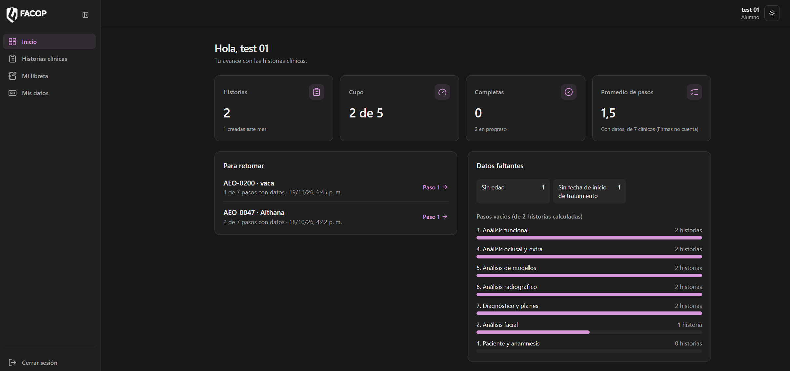 |

| Usuarios (administración) | Turmas |
|---|---|
| 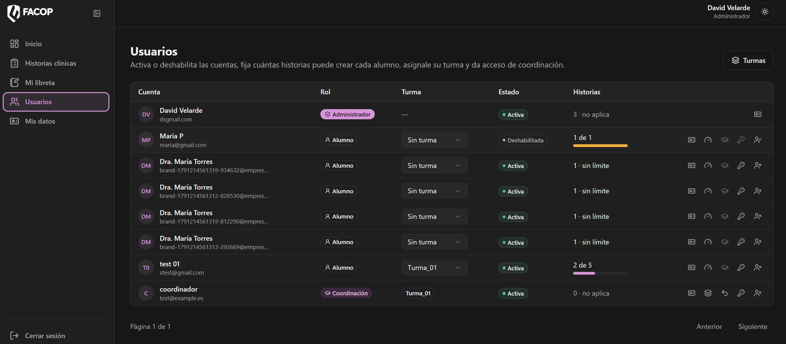 | 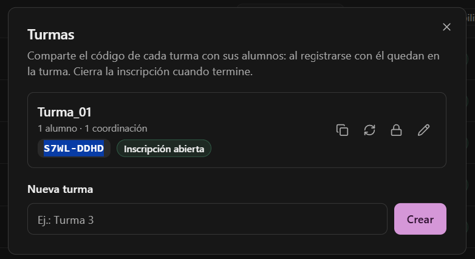 |

| Historias clínicas | Mi libreta (datos solo en el dispositivo) |
|---|---|
| 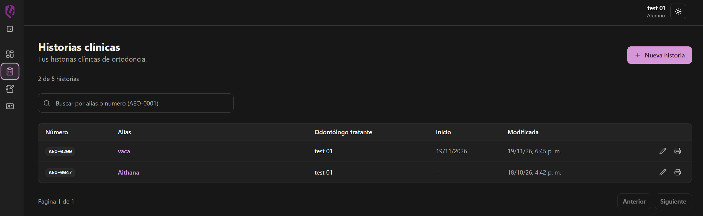 | 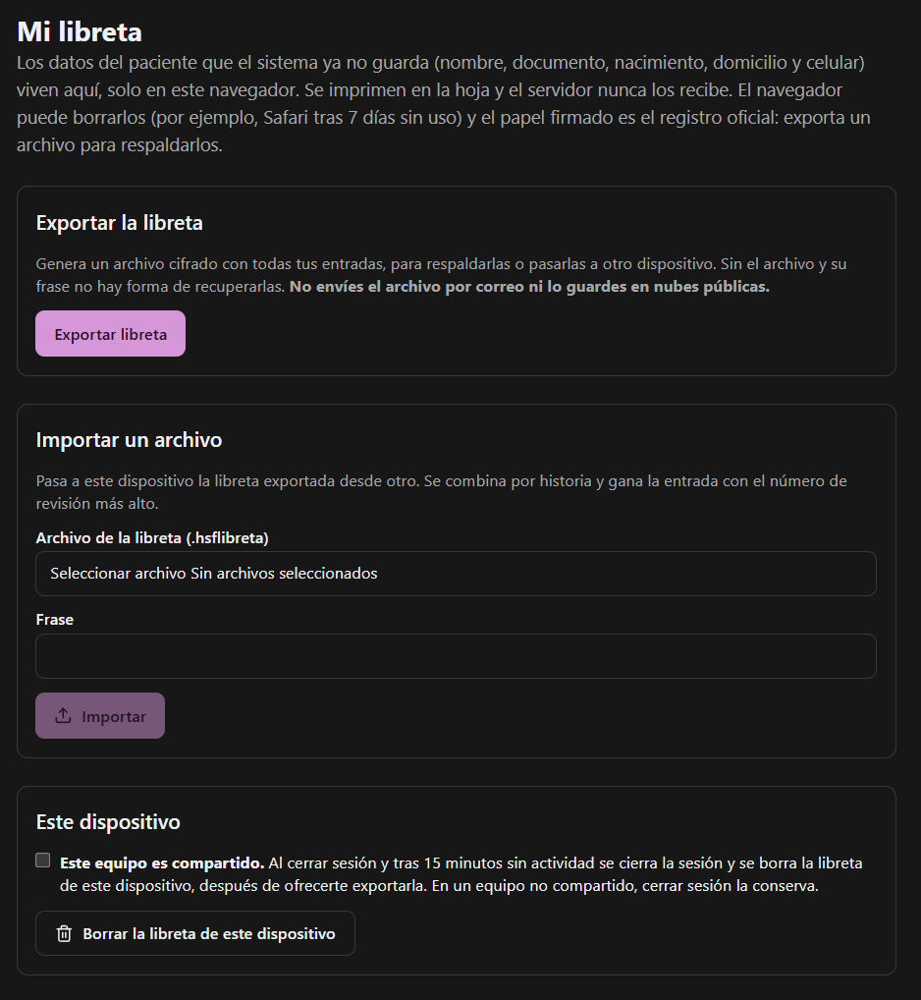 |

**Formulario por pasos** (pasos 2 a 8):

| Análisis facial | Análisis funcional | Análisis oclusal |
|---|---|---|
| 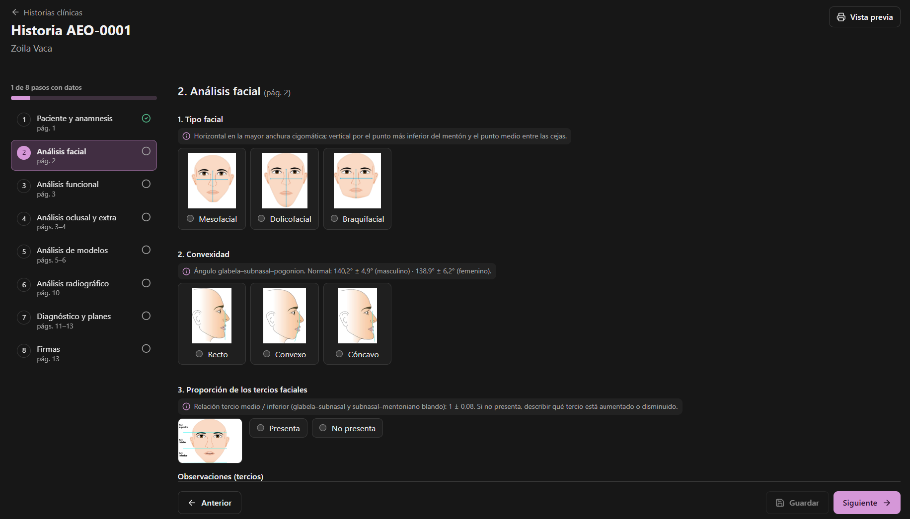 | 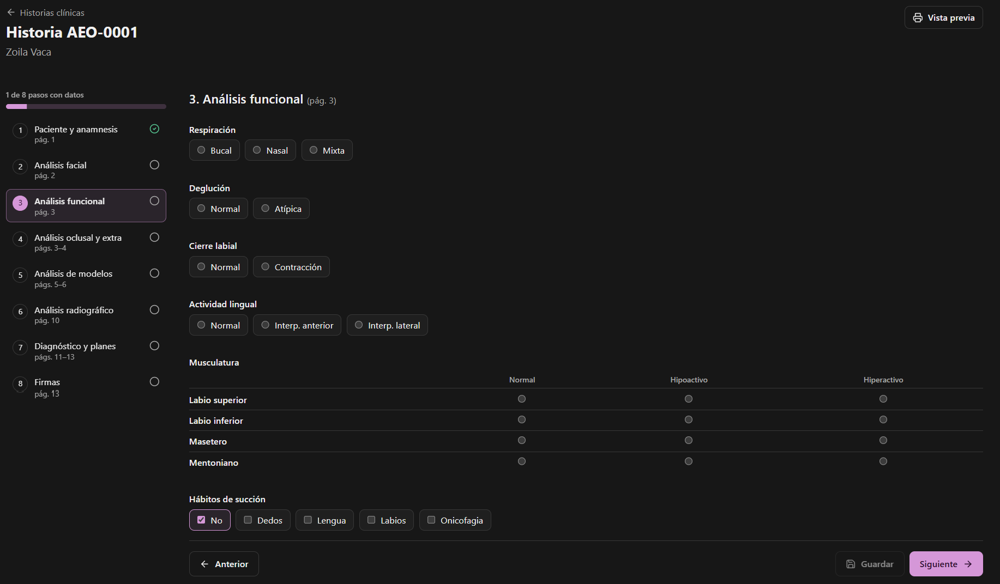 | 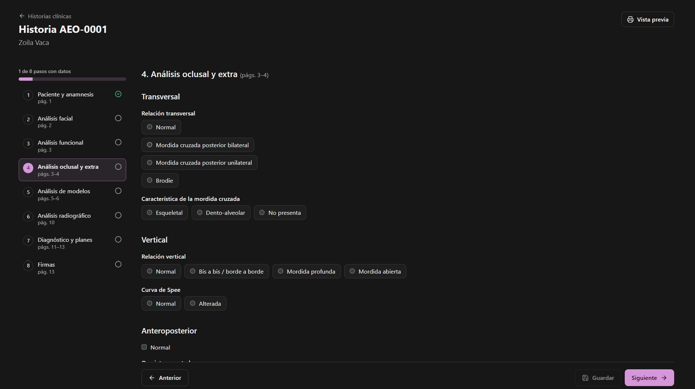 |

| Análisis de modelos | Radiográfico | Diagnóstico y planes | Firmas |
|---|---|---|---|
| 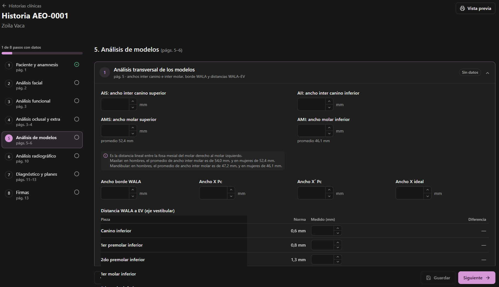 | 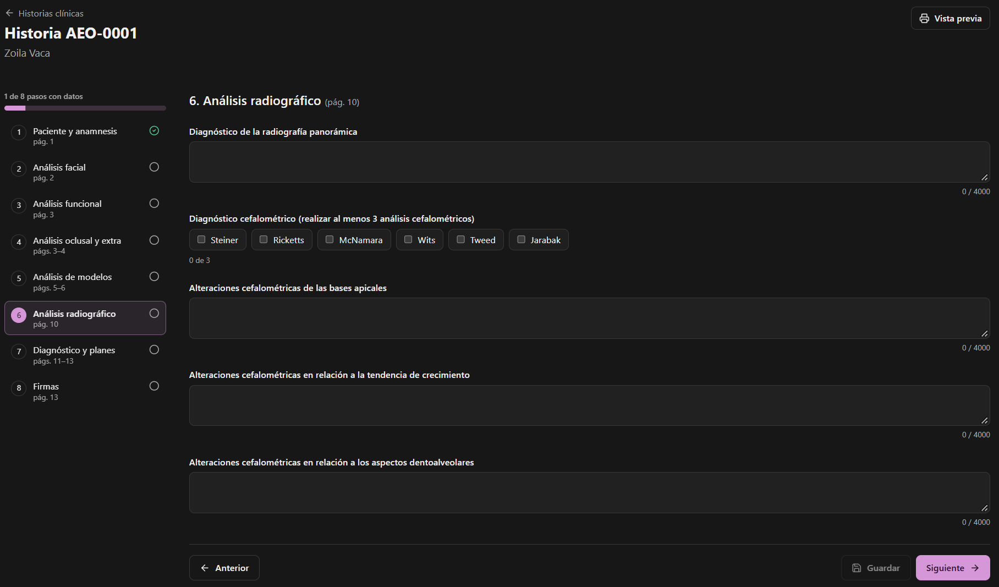 | 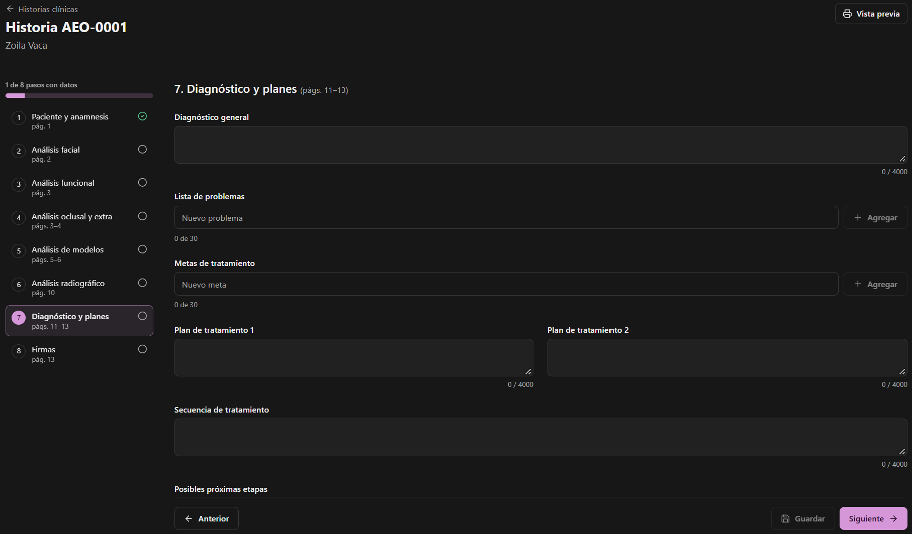 | 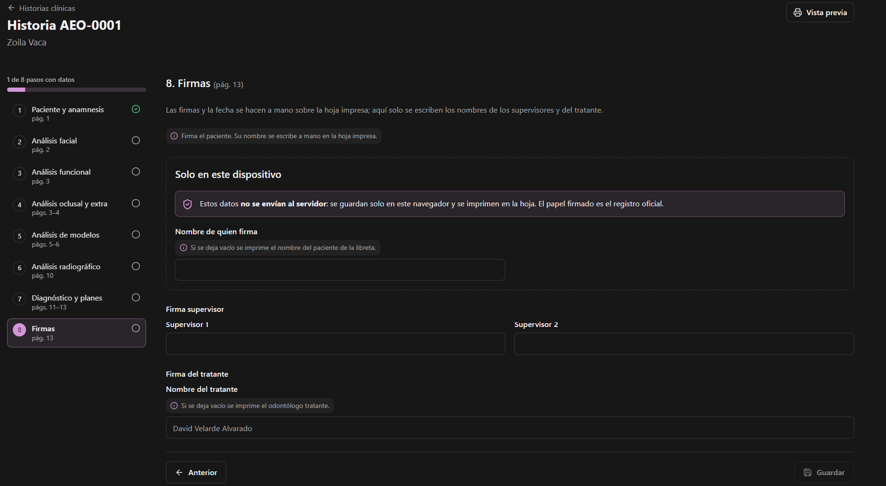 |

**Vista preliminar de impresión** (A4, fiel al formato oficial):

| Página 1 | Facial | Funcional |
|---|---|---|
| 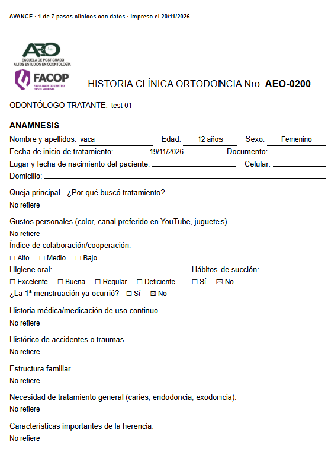 | 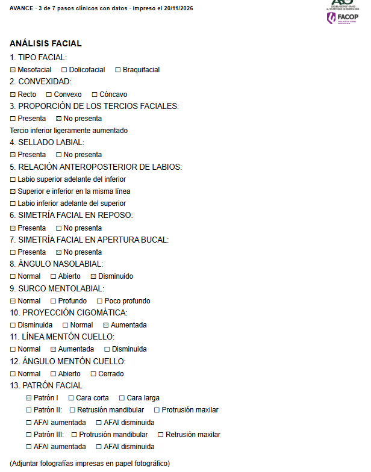 | 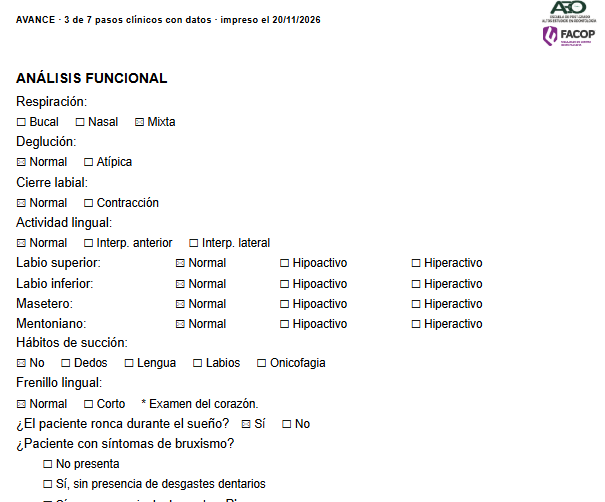 |

Mis datos: [`profile.png`](docs/screenshots/profile.png).

---

## Funcionalidades

Estado verificado contra el código (controladores, rutas, migraciones y pruebas), no solo contra las specs. Las capacidades con spec están en [`openspec/specs/`](openspec/specs/).

### Implementadas

| Módulo | Qué permite |
|---|---|
| **Autenticación** ([spec](openspec/specs/authentication/spec.md)) | Registro, inicio y cierre de sesión; renovación transparente de sesión; bloqueo temporal por intentos fallidos; cambio de contraseña y restablecimiento por enlace; rutas protegidas por rol (`ADMIN`, `USER`, `COORDINATOR`). |
| **Usuarios** ([spec](openspec/specs/users/spec.md)) | El administrador lista cuentas, las activa o deshabilita, asigna rol, turma y cupo de historias, y restablece contraseñas. Cada cuenta edita sus datos en "Mis datos". |
| **Turmas** ([spec](openspec/specs/cohorts/spec.md)) | Grupos de alumnos con código de inscripción y apertura/cierre; alta del alumno en su turma al registrarse; cuentas de coordinación con **supervisión de solo lectura**. |
| **Historias clínicas de ortodoncia** ([spec](openspec/specs/orthodontic-records/spec.md)) | Formulario de 8 pasos (paciente y anamnesis, facial, funcional, oclusal, modelos, radiográfico, diagnóstico y firmas); análisis de modelos transversal, Moyers, Nance, Bolton, Tanaka y Wolford con cálculos automáticos; autoguardado con control de versión (409 ante conflictos); cupo por tratante; datos del paciente que se fijan al imprimir, con solicitud de desbloqueo; vista preliminar e impresión A4 fiel al PDF; número de historia asignado por los docentes. |
| **Paciente por alias y libreta local** | El servidor guarda solo alias, sexo y edad del paciente. Nombre, documento, nacimiento, domicilio y celular viven **solo en el navegador** (IndexedDB), se unen a la hoja al imprimir y se respaldan con un archivo cifrado (AES-GCM). Incluye búsqueda local, modo de equipo compartido y copia de los datos antiguos con verificación. Specs en [`openspec/changes/`](openspec/changes/) (pendientes de archivar). |
| **Inicio (dashboard)** ([spec](openspec/specs/dashboard/spec.md)) | Métricas por rol: tratante (avance, datos faltantes, historias por retomar), administrador (cuentas, historias por mes, cupos) y coordinación (avance de sus turmas). |
| **Estructura de la aplicación** ([spec](openspec/specs/app-shell/spec.md)) | Layout privado responsive (sidebar contraíble, cajón móvil) con navegación filtrada por rol. |
| **Contratos de API** ([spec](openspec/specs/api-type-contracts/spec.md)) | Contrato OpenAPI versionado, cliente TypeScript generado y pruebas que detectan desvíos. |
| **Despliegue en la nube** ([spec](openspec/specs/cloud-deployment/spec.md)) | Frontend en Vercel, API en Render (Docker) y PostgreSQL en Neon; copia diaria cifrada de la base. Ver [`docs/deployment.md`](docs/deployment.md). |

### Parcialmente implementadas

- **Retiro de las columnas antiguas de identidad:** la copia de datos antiguos a la libreta y el script administrativo de migración están construidos; el borrado definitivo de las columnas es un segundo despliegue que depende de ejecutar ese script.

### Decisiones de producto

- Las notas de evolución de la historia se imprimen en blanco para llenarlas a mano.

---

## Arquitectura

**Monorepo modular:** `modules/backend` (Java/Spring) + `modules/frontend` (React/Vite), con el contrato en `contracts/openapi.json`.

**Backend** — API REST por capas, con las dependencias vigiladas por ArchUnit:

```
presentation (controllers, DTOs) → service → persistence (entidades JPA, repositorios)
infra (seguridad, configuración) · common
```

- Autorización por rol con Spring Security y `@PreAuthorize`; tokens JWT de acceso y refresco, este último en cookie `HttpOnly`, `Secure`, `SameSite=Lax`.
- Persistencia en PostgreSQL con Flyway (`ddl-auto=none`, 23 migraciones). Entidades: `User`, `Cohort`, `OrthodonticRecord`, `RecordUnlockEvent`, `RefreshToken`, `PasswordResetToken`.
- Errores en formato `ProblemDetail` (RFC 9457) con `traceId`; los registros del servidor no incluyen datos de pacientes.
- Endpoints bajo `/auth` y `/api` (usuarios, turmas, dashboard, historias, perfil); documentación OpenAPI apagada por defecto.

**Frontend** — SPA organizada por capacidad: `modules/{core,auth,users,cohorts,dashboard,records}`; las pantallas (`screens/`) solo montan el componente del módulo. Rutas por sección con guard de rol (`sectionRoute`), TanStack Query para datos del servidor, Zustand para estado de sesión y UI, react-hook-form + Zod con paridad respecto a Bean Validation, y la libreta local en `modules/records/notebook/`.

**Contrato:** springdoc genera `contracts/openapi.json`; `orval` produce el cliente tipado del frontend. Una prueba de integración (`ContractDriftIT`) y un job de CI detectan que el contrato o el cliente se desvíen.

Detalle en [`docs/architecture.md`](docs/architecture.md), [`docs/backend.md`](docs/backend.md) y [`docs/frontend.md`](docs/frontend.md).

---

## Stack tecnológico

| Área | Tecnologías |
|---|---|
| **Frontend** | React 19 · TypeScript · Vite · Tailwind CSS 4 + shadcn/Radix · TanStack Query · Zustand · react-hook-form + Zod · React Router 7 · axios · cliente generado con orval |
| **Backend** | Java 25 · Maven · Spring Boot 4 · Spring Web MVC · Spring Data JPA · Spring Security + JWT (`java-jwt`) · Bean Validation · springdoc-openapi · Actuator |
| **Base de datos** | PostgreSQL 16 · Flyway |
| **Testing** | JUnit 5 · Spring Boot Test · Testcontainers (PostgreSQL) · ArchUnit · Vitest · Testing Library · MSW · `fake-indexeddb` · Playwright |
| **DevOps y CI/CD** | GitHub Actions · Docker · Vercel · Render · Neon · copia diaria cifrada de la base (workflow `db-backup`) |
| **Herramientas** | pnpm · husky + commitlint (Conventional Commits en español) · ESLint · OpenSpec |

---

## Calidad y pruebas

Las pruebas **derivan de los `Scenario` de las specs** ([`docs/testing.md`](docs/testing.md)).

| Nivel | Qué hay | Cómo correrlo |
|---|---|---|
| **Unitarias y de slice (backend)** | JUnit 5 / Spring Boot Test sobre `src/test/java` | `./mvnw test` |
| **Integración (backend)** | Pruebas `*IT` contra PostgreSQL real con Testcontainers (requiere Docker): historias, bloqueo de datos del paciente, libreta, migración de identidad, contrato | `./mvnw verify` |
| **Arquitectura** | `LayeredArchitectureTest` (ArchUnit): `presentation` no depende de `persistence`, `persistence` no depende de `presentation` ni `service`, `service` no depende de `presentation` | incluido en `./mvnw verify` |
| **Componentes y lógica (frontend)** | Vitest + Testing Library + MSW; la libreta usa `fake-indexeddb` | `pnpm --filter odontorisas-frontend test` |
| **E2E** | Playwright en `modules/frontend/e2e`: *smoke* sin backend (autenticación, búsqueda, alias y libreta) y especificaciones `*.backend.spec.ts` que requieren backend y PostgreSQL | `pnpm --filter odontorisas-frontend test:e2e` |
| **Validación del frontend** | typecheck + lint + tests | `pnpm --filter odontorisas-frontend validate` |

**CI** ([`.github/workflows/`](.github/workflows/)):

- `backend.yml`: `./mvnw -B verify` con Java 25.
- `frontend.yml`: typecheck y lint, verificación de que el cliente generado coincide con el contrato, tests con cobertura (`test:coverage`) y E2E *smoke* en Chromium.
- `openspec.yml`: `openspec validate --all --strict`.
- `db-backup.yml`: copia diaria cifrada de la base, verificada por restauración.

No se publica cifra de cobertura: el informe se genera en cada ejecución de CI.

---

## Desarrollo guiado por especificaciones

Cada capacidad nace como un *change* de OpenSpec (`proposal.md`, `design.md`, `tasks.md` y un delta de spec), se implementa y, al archivarse, pasa a `openspec/specs/`.

- `openspec/specs/<capacidad>/spec.md`: lo **ya construido**, con `Requirement` (SHALL) y `Scenario` (WHEN/THEN).
- `openspec/changes/`: cambios en curso; `openspec/changes/archive/`: histórico.
- Trazabilidad: los tests se nombran a partir de los escenarios y `openspec validate --strict` corre en CI.
- Ciclo y reglas: [`SETUP-OPENSPEC.md`](SETUP-OPENSPEC.md) y [`docs/vision.md`](docs/vision.md).

---

## Instalación y ejecución

**Requisitos:** JDK 25 · Node 22 · pnpm · Docker (PostgreSQL local y pruebas de integración).

### 1. Dependencias y configuración
```bash
pnpm install                                         # todo el workspace
cp modules/backend/secrets.properties.example modules/backend/secrets.properties
```
Edita `secrets.properties`: base de datos, `JWT_SECRET` (al menos 32 bytes aleatorios, p. ej. `openssl rand -base64 48`; la app no arranca sin uno válido) y, si quieres Swagger local, `SWAGGER_ENABLED=true`. Este archivo no se versiona. El frontend solo necesita `modules/frontend/.env` si apunta a un backend distinto de `http://localhost:8080` (`VITE_API_URL`).

### 2. Backend
```bash
cd modules/backend
docker compose --env-file secrets.properties up -d   # PostgreSQL local
./mvnw spring-boot:run                               # http://localhost:8080
```
Con `SWAGGER_ENABLED=true`: contrato en `/v3/api-docs` y Swagger UI en `/swagger-ui.html`.

### 3. Frontend
```bash
pnpm --filter odontorisas-frontend dev               # http://localhost:5173
```

### 4. Verificación
```bash
cd modules/backend && ./mvnw verify                  # requiere Docker
pnpm --filter odontorisas-frontend validate
```

### Regenerar el cliente API (tras cambiar el contrato)
```bash
cd modules/backend && ./mvnw -B verify -Dit.test=ContractDriftIT -Dtest=none -Dsurefire.failIfNoSpecifiedTests=false -Dcontract.update=true
pnpm --filter odontorisas-frontend generate:api
```

### Variables de despliegue relevantes
`LEGACY_COPY_DEADLINE` (fecha límite para que cada tratante copie los datos antiguos a su libreta; vacía = ventana cerrada), `RECORDS_DEFAULT_QUOTA`, `CORS_ALLOWED_ORIGINS`, `COOKIE_SECURE`. Guía completa en [`docs/deployment.md`](docs/deployment.md).

---

## Documentación técnica

| Documento | Contenido |
|---|---|
| [`docs/vision.md`](docs/vision.md) | Objetivos de producto, roadmap y estado de las capacidades |
| [`docs/domain.md`](docs/domain.md) | Modelo de dominio: actores, glosario, entidades y diagrama ER |
| [`docs/architecture.md`](docs/architecture.md) | Stack y arquitectura de backend y frontend |
| [`docs/backend.md`](docs/backend.md) | Estándares Java/Spring: capas, DTOs, JPA, seguridad, errores |
| [`docs/frontend.md`](docs/frontend.md) | Estándares frontend: módulos, capa API, React Query, Zustand, libreta local |
| [`docs/coding-style.md`](docs/coding-style.md) | Estilo de código y paridad de validación Zod ↔ Bean Validation |
| [`docs/testing.md`](docs/testing.md) | Estrategia de pruebas y puente Scenario → test |
| [`docs/tooling-setup.md`](docs/tooling-setup.md) | Tooling reproducible: Vitest/MSW, husky/commitlint, CI |
| [`docs/deployment.md`](docs/deployment.md) | Despliegue en Vercel + Render + Neon, copias y migración de identidad |
| [`docs/commits.md`](docs/commits.md) | Estándar de commits (Conventional Commits en español) |
| [`docs/adr/`](docs/adr/) | Decisiones de arquitectura ([ADR-0001](docs/adr/0001-stack-y-estructura.md)) |
| [`openspec/`](openspec/) | Specs construidas, cambios en curso y archivo histórico |
| [`SETUP-OPENSPEC.md`](SETUP-OPENSPEC.md) | Flujo y comandos de OpenSpec |
| [`CLAUDE.md`](CLAUDE.md) | Guía para agentes de IA (reglas del proyecto) |

**Convenciones:** commits en español con Conventional Commits (hook `commit-msg`); gates antes de subir: `openspec validate <change> --strict`, `./mvnw verify` y `pnpm --filter odontorisas-frontend validate`; no se versionan secretos (`secrets.properties`, `.env`), `target/`, `dist/` ni `node_modules/`.
